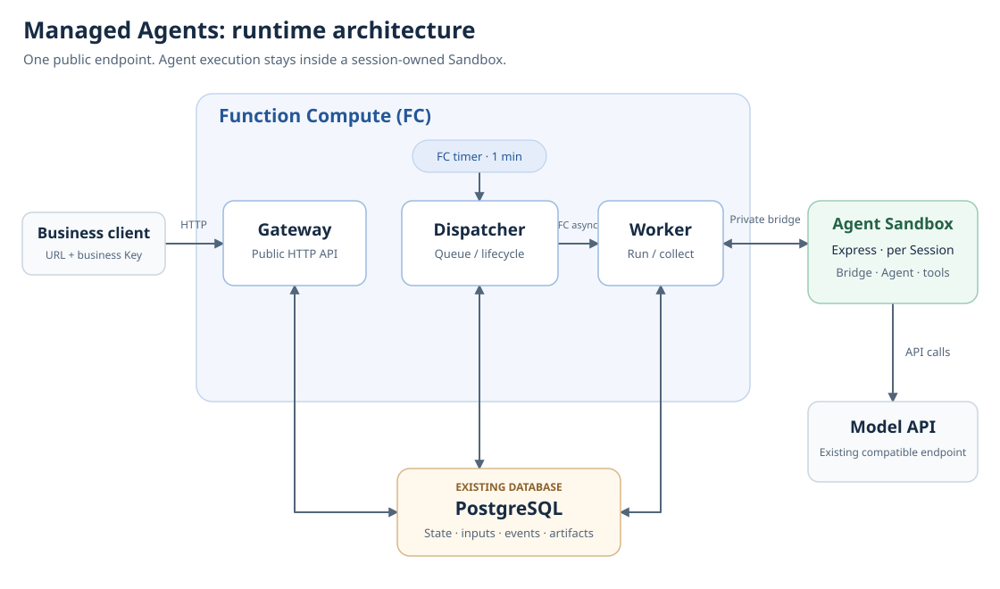

# agents-api

One stable Gateway endpoint for Agents whose model, tools and workspace run in a
session-owned Sandbox. Business clients configure the Gateway URL and business
key once.

[中文](README.zh-CN.md) · [API reference](../docs/managed-agents-api.md)

## What it does

Create logical sessions, upload inputs, run Codex or Qwen Code, follow durable
submissions and events, and download captured artifacts through the same Gateway.
The first input creates an exclusive Sandbox; later turns keep its native thread
and workspace. Close releases compute and retains results. Delete removes public
data while cleanup completes internally.

This is an OpenAI Agents inspired subset with explicit managed extensions. Read
`/v1/agent-sandbox/capabilities` for supported fields. A busy session rejects input
that cannot steer its current turn; use the explicit submission queue to enqueue
another turn. It does not provide the OpenAI hosted harness or promise arbitrary
OpenAI SDK compatibility.

## Stack

Alibaba generation-2 Sandbox base, non-root user, Node.js 24.16.0, Codex 0.162.1,
Qwen Code 0.23.0, PostgreSQL and FC Gateway/Worker/Dispatcher functions.

[template.yaml](template.yaml) · [Sandbox Dockerfile](Dockerfile) ·
[Server Dockerfile](server/Dockerfile)

The images pin SDK 0.4.0a7, which provides the managed Gateway and guest bridge.
Application deployment requires Node.js 20 or later and the npm distribution of
CLI 0.5.10. Business HTTP clients need only the Gateway endpoint and business key.

### Architecture and cloud services

Each deployment revision has three FC functions: Gateway, Dispatcher and Worker.
They share one Server image and start with different roles. Model calls, tools and
workspaces run in Agent Sandbox Express. Each Session owns a Sandbox, created on
its first task and reused across later turns.



| Module | Cloud product or service | Responsibility |
| --- | --- | --- |
| Gateway | Function Compute (FC) container function, HTTP trigger and function alias | Expose the business URL, authenticate requests, accept sessions, files and tasks, and serve status, events and artifact downloads |
| Dispatcher | FC container function and timer trigger | Read pending tasks, expiry and cleanup work from the database and schedule the Worker for the appropriate revision |
| Worker | FC container function invoked through FC asynchronous tasks | Create or reuse the Session Sandbox, submit and track tasks through the private bridge, and save events, results and artifacts to the database |
| Guest bridge, Qwen Code / Codex and workspace | Alibaba Cloud Agent Sandbox Express | Run the Agent tool loop and user code, call the model API and preserve the Session workspace |
| Durable state and file storage | Existing PostgreSQL, such as RDS for PostgreSQL | Store sessions, queue state, events, uploaded files and captured artifacts, using the current size-limited database storage backend |
| Model inference | Existing compatible model API, such as a Model Studio endpoint supporting the selected adapter | Called by the Agent inside the Sandbox; the deployer supplies a key, endpoint and available model ID |
| Image registry | Container Registry (ACR) | Store the Server and Sandbox images used by FC and Agent Sandbox |

A task follows this path:

1. The client uploads files and submits input to Gateway, which stores the data and pending work in PostgreSQL.
2. An FC timer invokes Dispatcher, currently once per minute. Dispatcher finds due work and invokes Worker through an FC asynchronous task. This interval can affect when a new task starts.
3. Worker creates or reuses the Session Sandbox and drives it through the private bridge. Qwen Code / Codex calls the model and executes tools inside the Sandbox.
4. Worker saves events and captured artifacts to PostgreSQL. The client reads progress and downloads results through Gateway. After the Session closes, saved results remain until the configured retention period expires.

### Resources to prepare

| Resource | Requirement | Preparation and deployment |
| --- | --- | --- |
| Available FC and Agent Sandbox Express accounts and permissions | Required | The deployer enables access and supplies configuration; `abx app` deploys the three FC functions, triggers and ingress, and prepares the Sandbox template. The runtime creates instances per Session |
| ACR registry and namespace | Required | The deployer prepares the registry and access; the build uploads images |
| PostgreSQL database | Required | Supply an existing reachable database and connection details; the template does not create or delete the database instance |
| Compatible model service | Required | Supply a model account, key, endpoint and model ID; `qwen-code` needs Chat Completions with tools, while `codex` needs Responses with tool turns |
| RAM deployment identity and FC execution role | Required | Select the deployment identity through an existing Serverless Devs access profile and supply an FC role ARN with the required internal function invocation permissions |
| VPC, vSwitches and security group | Conditional | For a database accessible only through a private network, supply existing network configuration and verify connectivity from all three FC functions to the database and required external services |
| Database CA chain | Conditional | Supply it when PostgreSQL uses a private CA; a publicly trusted certificate does not require an additional private CA |
| HTTPS custom domain and certificate | Prepare for production ingress as needed | The default provides an FC test domain; configure an existing domain and the corresponding HTTPS ingress for production use |

Gateway is an application module running on FC, so a separate API Gateway product
is not required. Queue state, files and artifacts currently reside in PostgreSQL;
the template does not require a separate message queue, Redis or OSS. RDS for
PostgreSQL and Model Studio are service options, not exclusive requirements. The
CLI, local Docker and Serverless Devs are deployment tools, not additional resident
services. See Configuration and Resources below for network, credentials and cleanup.

## Problem solved

Callers use one application endpoint instead of discovering an endpoint for each
Sandbox. Deployment credentials, database access and Sandbox management stay on
the Server. Only the selected model configuration and a separate generated guest
application token enter the Sandbox.

## Quick start (CLI)

Install the npm CLI below, configure your Sandbox/build registry with the
[usage guide](../docs/using-templates.md#installation), and select an existing
Serverless Devs access profile in `application.deployment.accessRef`. The FC
region, Sandbox region, database connectivity and registry image access must agree.
Keep the Python environment active when deploying: its `httpx==0.28.1` dependency
is used by the verification hook and examples.

```bash
npm install --global @agent-sandbox/cli@0.5.10
git clone https://github.com/Alibaba-Agent-Sandbox/awesome-templates.git
cd awesome-templates/agents-api
mkdir -p .abx
python3 -m venv .abx/venv
. .abx/venv/bin/activate
python -m pip install httpx==0.28.1
cp bindings.example.json .abx/bindings.json
chmod 600 .abx/bindings.json
```

Set the referenced environment variables described in Configuration before apply.
Choose an actual model ID and its matching adapter in the private bindings file.
Edit the manifest's region, access profile and limits for your account. Keep
private files, plans and build receipts under `.abx/`, excluded from image builds.

```bash
abx app build template.yaml --out .abx/build.json --yes
abx app plan template.yaml --build-receipt .abx/build.json --out .abx/plan.json
abx app apply .abx/plan.json --bindings .abx/bindings.json --yes
abx app status '<receipt_file returned by apply>'
```

Save the returned `endpoint`, `receipt_file` and `credentials_file`. The first
apply generates business/internal keys, stores them privately on this computer
and reuses them for later updates. Explicit custom credentials are not copied
into this store. Business callers need only the endpoint and `businessKey` from
the private credentials file; do not share its `internalToken`.

The built-in business check keeps local progress in `.abx/agents-smoke-reports/latest.json`
and a separate append-only `*.jsonl` file for each attempt. If Apply's check fails, inspect:

```bash
python -m json.tool .abx/agents-smoke-reports/latest.json
```

The report contains fixed phase/check codes, optional numeric HTTP and terminal status,
and cleanup booleans, without credentials, resource IDs, model output or raw exceptions.
A killed or timed-out check can leave `status: running`; that is not success. Reports require
an owner-private writable directory, and a report write failure keeps the check failed.
If the command prints `report_io`, the last report may be unavailable or from an earlier checkpoint.
`cleanup_confirmed` covers only known resources that this check tried to release; it does
not prove the absence of unknown requests or independently verify provider cleanup.
Preserve the application receipt and use Status/Reconcile after a failed Apply; do not replay
its creation steps merely to obtain another report.

For an update, build again, then plan with `--previous-receipt <receipt_file>` and
apply the new plan. Existing sessions remain assigned to their original revision.
Keep the earlier receipt until its sessions drain. Retire an old revision with
`abx app retire <current-receipt> --revision <retained-revision> --bindings .abx/bindings.json --yes`.
Retirement requires that the revision no longer owns a reusable Session or unresolved
cleanup; close its Sessions first.

## Quick start (Python SDK)

The Gateway accepts standard HTTP; no Sandbox SDK or individual Sandbox address
is needed. Set `AGENTS_API_BASE_URL` to the returned endpoint and
`AGENTS_CREDENTIALS_FILE` to the returned private credentials file. This example
creates a session with an initial task and waits for its durable submission.

```python
import json, os, time
from pathlib import Path
import httpx

key = json.loads(Path(os.environ["AGENTS_CREDENTIALS_FILE"]).read_text())["businessKey"]
with httpx.Client(base_url=os.environ["AGENTS_API_BASE_URL"],
                  headers={"Authorization": "Bearer " + key}, timeout=30) as api:
    models = api.get("/v1/models").raise_for_status().json()["data"]
    response = api.post("/v1/agents/sessions",
        headers={"Idempotency-Key": "my-first-session"},
        json={"agent": {"model": models[0]["id"]},
              "input": "Write and run /workspace/outputs/hello.py printing hello."})
    response.raise_for_status()
    session = response.json()["id"]
    submission = response.headers["X-Agent-Sandbox-Submission-Id"]
    try:
        deadline = time.monotonic() + 660
        while time.monotonic() < deadline:
            value = api.get(f"/v1/agent-sandbox/sessions/{session}/submissions/{submission}").raise_for_status().json()
            if value["status"] in {"completed", "failed", "cancelled", "uncertain"}:
                break
            time.sleep(1)
        else:
            raise TimeoutError("Read the submission again; a client timeout does not cancel it")
        print(value["status"], value.get("turn_id"))
        # Download captured artifacts through /v1/agents/sessions/{session}/artifacts.
    finally:
        closed = api.post(f"/v1/agent-sandbox/sessions/{session}/close", json={})
        closed.raise_for_status()
        print("Cleanup operation:", closed.json()["id"])
```

Poll `/v1/agent-sandbox/operations/{id}` until close succeeds before considering
compute released. A failed or uncertain operation needs reconciliation; keep its
ID. Saved results remain available after successful close until retention expires.
For a complete upload/two-turn/download example, run `scripts/smoke.py` with
`AGENTS_API_BASE_URL` and `AGENTS_API_KEY` supplied from the same private store.

The image includes a CSV exercise with a deliberate aggregation defect and original
tests under `/workspace/agents-api-demo`. Attachments target `/workspace/input/`;
the CSV exercise uses `/workspace/input/sales.csv`. The full example asks the Agent to repair
the existing `aggregate.py`, run its original tests, and publish the summary, repair
report and modified source. The next turn adds shares to the same program. The
example downloads each turn's artifact version through the Gateway and independently
checks amounts and shares; it never executes generated code on the host. The exercise
directory does not replace your own files.

## Quick start (HTTP POST)

Read the business key from your private store into `AGENTS_API_KEY` without
printing it. Replace `model-id` with an ID returned by `/v1/models`.

```bash
curl --fail-with-body -X POST "$AGENTS_API_BASE_URL/v1/agents/sessions"   -H "Authorization: Bearer $AGENTS_API_KEY"   -H 'Content-Type: application/json' -H 'Idempotency-Key: example-session-1'   -d '{"agent":{"model":"model-id"},"input":"Create /workspace/outputs/hello.txt containing hello."}'
```

Session creation returns 201. Later input through `POST .../{session}/events`
returns 202 with an empty body and a submission receipt header. Poll that receipt
and its specific turn; an HTTP success or a disconnected stream does not prove
the Agent task completed.

## Command reference

[API reference](../docs/managed-agents-api.md) lists the public operations.

| Entry | Parameters | Result |
| --- | --- | --- |
| `POST /v1/agents/sessions` | `agent`, optional `input`, metadata and input-file extension | Logical Session; initial input also returns a receipt header. |
| `POST /v1/agents/sessions/{id}/events` | Supported input or cancellation events | 202; durable receipt in headers. |
| `POST /v1/agent-sandbox/sessions/{id}/submissions` | Input; required `Idempotency-Key` | Explicit queued Submission. |
| `POST /v1/agent-sandbox/sessions/{id}/close` | Empty object | Cleanup Operation; retains committed results. |
| `DELETE /v1/agents/sessions/{id}` | Closed or idle Session ID | Public deletion; executing/collecting sessions return 409. |

The private bridge is not the business API. `commands.py` contains a local
`agents_version()` diagnostic with no arguments; it checks installed CLI versions
and returns their pinned versions. It is not exposed by the private bridge.

## Configuration

Copy [bindings.example.json](bindings.example.json). Its `{env: ...}` values are
references resolved at apply; the file contains no credential literals.

| Variable or binding | Purpose and source |
| --- | --- |
| `ABX_MANAGED_DATABASE_URL` | Existing PostgreSQL connection URL; obtain from your database service. All three FC roles need network access. This template does not provision or delete PostgreSQL. |
| `SANDBOX_API_KEY` | Existing Sandbox platform API key from your Sandbox access setup; used by Worker/Dispatcher for lifecycle operations. |
| `SANDBOX_BASE_URL`, `SANDBOX_DOMAIN`, `SANDBOX_REGION` | Explicit API address, Sandbox endpoint domain and region from the same platform configuration. |
| `OPENAI_API_KEY`, `OPENAI_BASE_URL`, `OPENAI_MODEL` | Model-provider key, compatible API base and exact allowed model ID. `qwen-code` requires Chat Completions with tools; `codex` requires Responses with tools. A simple text request is insufficient. |
| `AGENTS_FC_ROLE_ARN` | Existing FC execution role permitted to invoke the revision's private Worker/Dispatcher functions. Obtain its ARN from your RAM/FC setup. |
| `agents-clientAuth`, `agents-internalAuth` | Default `generate: true` creates distinct business and internal keys on first apply. For custom business keys provide only SHA-256 hashes, owner and supported scopes. |
| `agents-ingress` | Default function alias plus FC test domain. For production use an explicitly configured HTTPS custom-domain binding. |

For a database reachable only over your VPC, replace the `agents-state` object
in the private bindings file with the following shape. Set these references to an
existing VPC, one or more distinct vSwitch IDs and its security group in the FC
region; the platform/network owner supplies these resource IDs.

```json
{
  "databaseUrl": {"env": "ABX_MANAGED_DATABASE_URL"},
  "vpcConfig": {
    "vpcId": {"env": "AGENTS_VPC_ID"},
    "vSwitchIds": [{"env": "AGENTS_VSWITCH_ID"}],
    "securityGroupId": {"env": "AGENTS_SECURITY_GROUP_ID"}
  }
}
```

The three FC roles use this existing network configuration. The template does not
create a VPC, vSwitch, security group, route or NAT gateway. FC public internet
access remains enabled, but you must verify actual database, image-registry,
Sandbox API and model endpoint connectivity under your routing and security
rules. Do not assume that selecting a VPC makes every external service reachable.
If PostgreSQL uses a private certificate authority, add `databaseCa` beside
`databaseUrl` in that object, for example
`"databaseCa": {"file": "/absolute/path/to/database-ca.pem"}`. Obtain the CA chain
from your database provider or administrator and keep `sslmode=verify-full` in
the database URL. Use the database hostname covered by its certificate.

`databaseCa` accepts a certificate PEM string, an `{env: "AGENTS_DATABASE_CA_PEM"}`
reference, or a `{file: "host-path"}` reference. File paths are read on the CLI
host. Relative paths are resolved from the bindings JSON directory, or from the
current directory for environment-only bindings; an absolute path avoids ambiguity.
The chain is limited to 64 KiB and eight valid
`CERTIFICATE` blocks, with no private key. Only the Server uses this trust
configuration; it is not placed in the Sandbox, image, plan or receipt.

The database binding also accepts a plain PostgreSQL URL string when no VPC
or CA configuration is needed. Keep the same database for an application's updates,
status and cleanup; the CLI checks its saved durable identity automatically.

`ABX_SERVER_TOKEN` is a separate per-Sandbox application token generated by the
runtime. It is not a cloud-console API key and needs no manual setup here.

## Resources

The Sandbox requests 2 vCPU and 4096 MiB. Default session idle/max lifetime is
900/3600 seconds; one turn per session executes at a time. Turn/tool budgets are
600/60 seconds. File and artifact limits are 10 MiB each and retained owner storage
is 100 MiB; check the manifest for all admission limits.

FC, registry storage, Sandbox runtime, database and model usage can incur charges.
The built-in FC function URL is a test entry and has provider limitations; it is
not a production SLA. Same-UID Agent tools can read their injected model key and
modify their workspace. Captured Agent output is not an independent execution
attestation. Restart or uncertain delivery freezes work for reconciliation rather
than silently replaying a tool action.

Close individual sessions when finished, download needed results and delete
public session/file data. To remove this deployment:

```bash
abx app plan --destroy '<receipt_file>' --out .abx/destroy-plan.json
abx app destroy .abx/destroy-plan.json --bindings .abx/bindings.json --yes
```

Check the resulting receipt and reconcile any retained owned resources. Destroy
and revision retirement remove only the recorded owned Server image tags when
no retained revision uses them. A supplied `serverImage` is borrowed and is never
deleted automatically.

If a Server build failed or will not be deployed, use
`abx app clean-build .abx/build.json --yes` to clean its confirmed owned image.
Once that build has entered any Apply, use application Destroy or Retire; Clean-build
refuses it, including after a failed Apply. Preserve uncertain build receipts for
reconciliation instead of deleting an unconfirmed tag manually.

Sandbox image builds can remain for manual cleanup. Review
`retained_build_artifacts` and the saved revision/build receipts, then remove
only your unused image tags using the registry's cleanup instructions. A successful
application Destroy does not mean every build artifact was removed. Borrowed
databases, VPC/network resources, model accounts and custom domains remain yours
to manage. Deployment destruction does not mean separately retained database
history was erased.

## Contributing

Follow [CONTRIBUTING.md](../CONTRIBUTING.md) and the
[template specification](../docs/template-spec.md). Keep both languages aligned.

## Issues

Report recipes/spec issues to [awesome-templates](https://github.com/Alibaba-Agent-Sandbox/awesome-templates/issues),
Gateway/bridge/runtime issues to [python-sdk](https://github.com/Alibaba-Agent-Sandbox/python-sdk/issues),
and deployment command issues to [agent-sandbox](https://github.com/Alibaba-Agent-Sandbox/agent-sandbox/issues).
Remove keys, database URLs and private logs from reports.

## License

Apache-2.0; see [LICENSE](../LICENSE). Upstream CLIs retain their own licenses.
