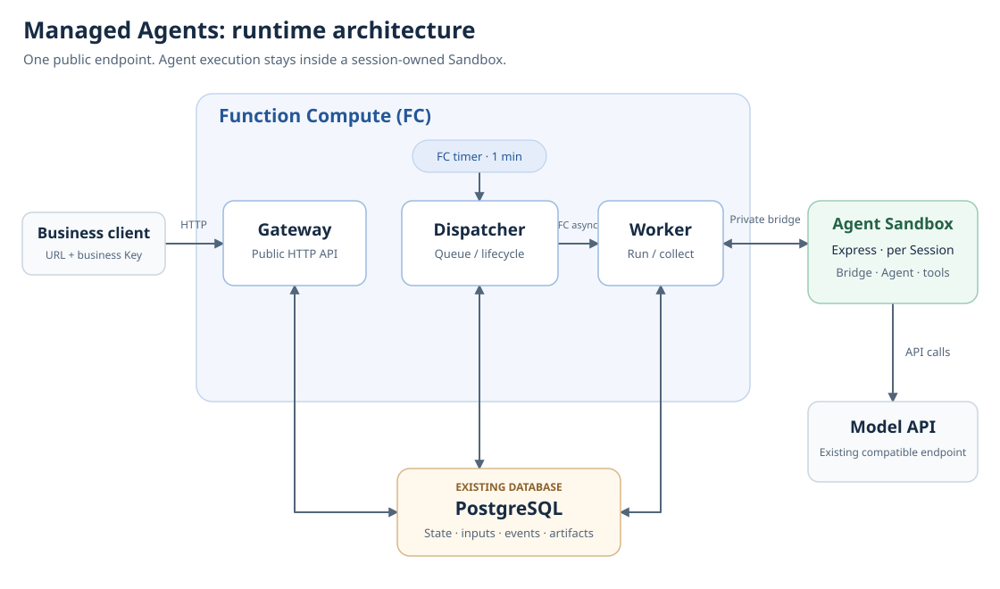

# agents-api

业务客户端只配置一个 Gateway endpoint 和业务 Key。Agent 的模型调用、工具和工作区
运行在 Session 独占的 Sandbox 中。

[English](README.md) · [API 参考](../docs/managed-agents-api.zh-CN.md)

## 做什么

通过同一个 Gateway 创建逻辑 Session、上传输入、运行 Codex 或 Qwen Code、查询持久化
Submission 和事件、下载产物。首次输入按需创建 Sandbox；后续轮次继续使用原生线程和
工作区。Close 释放计算并保留结果，Delete 删除公开数据，内部继续处理必要的资源清理。

这是参考 OpenAI Agents 的子集及明确的托管扩展。受支持字段见
`/v1/agent-sandbox/capabilities`，不承诺 OpenAI 托管 harness 或任意 OpenAI SDK 兼容。
忙碌时不能引导当前轮次的输入会被拒绝；需要排队时使用显式 Submission 队列。

## 技术栈

阿里云第二代 Sandbox 基础镜像、非 root 用户、Node.js 24.16.0、Codex 0.162.1、
Qwen Code 0.23.0、PostgreSQL，以及 FC Gateway/Worker/Dispatcher 函数。

[template.yaml](template.yaml) · [Sandbox Dockerfile](Dockerfile) ·
[Server Dockerfile](server/Dockerfile)

镜像固定使用 SDK 0.4.0a7，提供托管 Gateway 和 guest bridge。部署应用需要 Node.js 20
或更高版本，以及 当前源码 CLI。业务 HTTP 客户端只需要 Gateway endpoint 和业务 Key。

### 技术架构与云产品

一个部署版本包含 Gateway、Dispatcher、Worker 三个 FC 函数，共用 Server 镜像并按角色启动。
Agent 的模型调用、工具执行和工作区位于 Agent Sandbox 极速版中；每个 Session 独占一个
Sandbox，首次任务时按需创建，后续轮次复用。



| 模块 | 使用的云产品或服务 | 职责 |
| --- | --- | --- |
| Gateway | 函数计算 FC 容器函数、HTTP 触发器与函数别名 | 提供统一业务 URL，鉴权，接收 Session、文件和任务请求，查询状态、事件并下载产物 |
| Dispatcher | 函数计算 FC 容器函数、定时触发器 | 定期读取数据库中的待执行任务及到期、清理工作，调度对应版本的 Worker |
| Worker | 函数计算 FC 容器函数，通过 FC 异步任务调用 | 创建或复用 Session 的 Sandbox，经私有 bridge 提交和跟踪任务，将事件、结果和产物保存到数据库 |
| Guest bridge、Qwen Code / Codex、工作区 | 阿里云 Agent Sandbox 极速版 | 执行 Agent 工具循环和用户代码，调用模型服务，维持同一 Session 的工作区 |
| 持久状态与文件存储 | 已有 PostgreSQL，可选择 RDS PostgreSQL | 保存 Session、任务队列状态、事件、上传文件及已捕获产物；当前使用有大小限制的数据库存储 |
| 模型推理 | 已有兼容模型 API，例如支持所选 adapter 的百炼端点 | 由 Sandbox 内的 Agent 调用；部署者提供 Key、接口地址及实际可用的模型 ID |
| 镜像仓库 | 容器镜像服务 ACR | 存放 Server 和 Sandbox 两类镜像，供 FC 和 Agent Sandbox 使用 |

一次任务的主要过程：

1. 客户端向 Gateway 上传文件并提交输入，Gateway 将数据和待执行任务保存到 PostgreSQL。
2. FC 定时触发 Dispatcher；当前部署配置为每分钟一次。Dispatcher 查询待处理工作，通过 FC 异步任务调用 Worker。新任务启动可能受这一调度间隔影响。
3. Worker 创建或复用 Session 的 Sandbox，通过私有 bridge 驱动任务。Qwen Code / Codex 在 Sandbox 内调用模型并执行工具。
4. Worker 将事件和捕获的产物写回 PostgreSQL；客户端通过 Gateway 查询进度和下载结果。关闭 Session 后，已保存的结果保留到配置的保留期结束。

### 部署前需要准备哪些资源

| 资源 | 是否需要 | 准备与部署方式 |
| --- | --- | --- |
| 函数计算 FC、Agent Sandbox 极速版的可用账号及权限 | 必需 | 部署者开通并提供访问配置；`abx app` 部署三个 FC 函数、触发器和入口，并准备 Sandbox 模板；运行时按 Session 创建实例 |
| ACR 镜像仓库及命名空间 | 必需 | 部署者提前准备并配置访问权限；构建过程上传镜像 |
| PostgreSQL 数据库 | 必需 | 部署者提供已有可达数据库及连接信息；模板不创建或删除数据库实例 |
| 兼容模型服务 | 必需 | 部署者准备模型账号、Key、endpoint 和模型 ID；`qwen-code` 使用支持工具调用的 Chat Completions，`codex` 使用支持工具回合的 Responses |
| RAM 部署身份与 FC 执行角色 | 必需 | 部署身份通过已有 Serverless Devs access 配置选择；提供具有所需内部函数调用权限的 FC 角色 ARN |
| VPC、交换机、安全组 | 按需 | 数据库仅允许私网访问时，提供已有网络配置，并确认三个 FC 函数可达数据库及所需外部服务 |
| 数据库 CA 链 | 按需 | PostgreSQL 使用私有 CA 时提供；公开受信任证书不需要额外配置私有 CA |
| HTTPS 自定义域名及证书 | 生产入口按需准备 | 默认提供 FC 测试域名；生产使用时配置已有域名及相应 HTTPS 入口 |

Gateway 是本应用部署在 FC 上的模块，无需另行部署 API 网关产品。当前模板将队列状态、
文件和产物保存在 PostgreSQL，不要求额外配置消息队列、Redis 或 OSS。RDS PostgreSQL 和
百炼是可选的具体服务，不是唯一选择。CLI、本机 Docker 和 Serverless Devs 用于构建部署，
不作为额外的常驻服务。网络、凭据及清理方式见下文“配置”和“资源”。

## 解决的问题

调用方只连接应用 endpoint，无需逐个发现 Sandbox 地址。部署凭据、数据库连接和
Sandbox 管理凭据留在 Server；Sandbox 只接收选定的模型配置和单独生成的应用令牌。

## 快速开始（CLI）

这些命令需要当前源码 CLI，已发布的 0.5.10 不支持。先按[使用指南](../docs/using-templates.md#installation)
配置 Sandbox 及镜像构建仓库，并在 `application.deployment.accessRef` 选择已有的
Serverless Devs access。FC 地域、Sandbox 地域、数据库网络和镜像仓库访问需要相互匹配。
部署期间保持 Python 虚拟环境激活，验证 hook 和示例需要其中的 `httpx==0.28.1`。

```bash
git clone https://github.com/Alibaba-Agent-Sandbox/awesome-templates.git
cd awesome-templates/agents-api
mkdir -p .abx
python3 -m venv .abx/venv
. .abx/venv/bin/activate
python -m pip install httpx==0.28.1
cp bindings.example.json .abx/bindings.json
chmod 600 .abx/bindings.json
```

Apply 前提供“配置”表中的环境变量，在私有 binding 文件中选择实际可用的模型 ID 和
对应 adapter，并修改清单中的地域、access 和资源限制。私有文件、构建收据和计划存放在 `.abx/` 下，该目录不进入镜像构建上下文。

```bash
abx deploy . --name agents-api --bindings .abx/bindings.json --yes
abx status agents-api
```

`abx status agents-api` 显示 endpoint 和本机私有凭据文件路径。首次部署自动生成独立的业务及内部 Key，后续更新复用。业务客户端只需要 endpoint 和该文件中的 `businessKey`，不要分享 `internalToken`。显式提供的自定义凭据不会复制保存。

```bash
abx logs agents-api
abx recover agents-api
```

`abx logs` 需要配置 FC `logConfig`；本模板默认不配置。未配置时，请在 FC 控制台查看可用的函数诊断信息。

部署中断后先执行 `recover` 查看已知资源和恢复提示，不重复提交创建请求。修改模板或配置后，使用相同名称再次执行 `abx deploy . --name agents-api --bindings .abx/bindings.json --yes` 更新。已有 Session 保留原 revision；先关闭其 Session，再清理未使用的旧版本：

```bash
abx status agents-api --revisions
abx delete agents-api --revision <旧版本> --bindings .abx/bindings.json --yes
```

作者需要分开构建和部署时，可选用 `abx template build . --out .abx/build.json --yes`，再通过 `abx deploy . --build .abx/build.json --name agents-api --bindings .abx/bindings.json --yes` 复用构建。发布源码使用 `abx template publish`，不会自动上架 Registry。

## 快速开始（Python SDK）

Gateway 使用标准 HTTP，无需 Sandbox SDK 或单个 Sandbox 地址。设置
`AGENTS_API_BASE_URL` 为返回的 endpoint，`AGENTS_CREDENTIALS_FILE` 为返回的本机私有
凭据文件路径。下面创建带初始任务的 Session，并查询其持久化 Submission。

```python
import json, os, time
from pathlib import Path
import httpx

key = json.loads(Path(os.environ["AGENTS_CREDENTIALS_FILE"]).read_text())["businessKey"]
with httpx.Client(base_url=os.environ["AGENTS_API_BASE_URL"],
                  headers={"Authorization": "Bearer " + key}, timeout=30) as api:
    models = api.get("/v1/models").raise_for_status().json()["data"]
    response = api.post("/v1/agents/sessions",
        headers={"Idempotency-Key": "my-first-session"},
        json={"agent": {"model": models[0]["id"]},
              "input": "Write and run /workspace/outputs/hello.py printing hello."})
    response.raise_for_status()
    session = response.json()["id"]
    submission = response.headers["X-Agent-Sandbox-Submission-Id"]
    try:
        deadline = time.monotonic() + 660
        while time.monotonic() < deadline:
            value = api.get(f"/v1/agent-sandbox/sessions/{session}/submissions/{submission}").raise_for_status().json()
            if value["status"] in {"completed", "failed", "cancelled", "uncertain"}:
                break
            time.sleep(1)
        else:
            raise TimeoutError("客户端超时不取消执行，请继续查询 Submission")
        print(value["status"], value.get("turn_id"))
        # 使用 /v1/agents/sessions/{session}/artifacts 下载已捕获产物。
    finally:
        closed = api.post(f"/v1/agent-sandbox/sessions/{session}/close", json={})
        closed.raise_for_status()
        print("清理操作：", closed.json()["id"])
```

继续查询 `/v1/agent-sandbox/operations/{id}`，直到 Close 成功，才可以认为计算已释放。
失败或不确定的操作需要协调处理，请保存其 ID。关闭后已保存的结果仍可读取，直到保留期
结束。完整的上传、两轮真实 Agent 处理和产物下载示例见 `scripts/smoke.py`；为其提供同一
私有凭据中的 `AGENTS_API_KEY` 和 `AGENTS_API_BASE_URL`。

镜像在 `/workspace/agents-api-demo` 提供一个有意保留聚合缺陷的 CSV 练习和原始测试。
附件目标位于 `/workspace/input/`，CSV 练习使用 `/workspace/input/sales.csv`。
完整示例先让 Agent 修复现有 `aggregate.py`，运行原始测试，生成汇总、说明和修改后的源码；
第二轮继续给同一个程序增加占比列。示例从 Gateway 下载每一轮的独立产物版本，并核对
金额和占比，不在宿主机执行 Agent 生成的代码。这个练习目录不覆盖你自己的文件。

## 快速开始（HTTP POST）

从私有文件读取业务 Key 到 `AGENTS_API_KEY`，不要打印值。`model-id` 使用
`/v1/models` 返回的实际模型 ID。

```bash
curl --fail-with-body -X POST "$AGENTS_API_BASE_URL/v1/agents/sessions" \
  -H "Authorization: Bearer $AGENTS_API_KEY" \
  -H 'Content-Type: application/json' -H 'Idempotency-Key: example-session-1' \
  -d '{"agent":{"model":"model-id"},"input":"Create /workspace/outputs/hello.txt containing hello."}'
```

创建 Session 返回 201。后续 `POST .../{session}/events` 返回 202、空响应体及
Submission 收据头。查询收据和对应 Turn 判断执行结果；HTTP 成功或流断开都不表示
Agent 已完成任务。

## 命令参考

[API 参考](../docs/managed-agents-api.zh-CN.md)列出公开操作。

| 入口 | 参数 | 结果 |
| --- | --- | --- |
| `POST /v1/agents/sessions` | `agent`、可选 `input`、metadata 和输入文件扩展 | 逻辑 Session；带初始输入时还返回收据头。 |
| `POST /v1/agents/sessions/{id}/events` | 受支持的输入或取消事件 | 202；收据位于响应头。 |
| `POST /v1/agent-sandbox/sessions/{id}/submissions` | 输入及必需的 `Idempotency-Key` | 显式排队的 Submission。 |
| `POST /v1/agent-sandbox/sessions/{id}/close` | 空对象 | 清理 Operation；保留已提交结果。 |
| `DELETE /v1/agents/sessions/{id}` | 已关闭或空闲 Session ID | 删除公开资源；正在执行或采集时返回 409。 |

私有 bridge 不是业务 API。`commands.py` 中的本机 `agents_version()` 无参数，只检查
安装的 CLI 并返回固定版本；私有 bridge 不开放该命名命令。

清单省略了 `fc-managed-agents` profile 的固定字段。按需修改显式声明的提供方、binding 引用、地域和预算；默认值与允许的覆盖见 [profile 参考](../docs/managed-agent-applications.zh-CN.md)。

## 配置

复制 [bindings.example.json](bindings.example.json)。其中 `{env: ...}` 是 Apply 时解析的
引用，不在文件中填写凭据明文。

| 环境变量或 binding | 用途与来源 |
| --- | --- |
| `ABX_MANAGED_DATABASE_URL` | 已有 PostgreSQL 连接 URL，由数据库服务提供；三个 FC 角色都需要网络可达。本模板不创建或删除 PostgreSQL。 |
| `SANDBOX_API_KEY` | 已有 Sandbox 平台 API Key，由 Sandbox 访问配置获得；Worker/Dispatcher 用于生命周期管理。 |
| `SANDBOX_BASE_URL`、`SANDBOX_DOMAIN`、`SANDBOX_REGION` | 同一平台配置中的 API 地址、Sandbox endpoint 域名和地域，全部显式提供。 |
| `OPENAI_API_KEY`、`OPENAI_BASE_URL`、`OPENAI_MODEL` | 模型服务 Key、兼容接口地址和准确模型 ID。`qwen-code` 需要带工具的 Chat Completions；`codex` 需要带工具的 Responses。简单文本调用成功不足以证明兼容。 |
| `AGENTS_FC_ROLE_ARN` | 已有 FC 执行角色 ARN，需具备调用该 revision 私有 Worker/Dispatcher 函数的权限；从 RAM/FC 配置获取。 |
| `agents-clientAuth`、`agents-internalAuth` | 默认 `generate: true` 在首次 Apply 生成不同的业务和内部 Key。自定义业务凭据只提供 SHA-256 摘要、owner 和受支持 scopes。 |
| `agents-ingress` | 默认函数 alias 和 FC 测试域名；生产环境使用显式配置的 HTTPS 自定义域名 binding。 |

数据库只能通过 VPC 访问时，将私有 binding 文件中的 `agents-state` 对象替换为以下
形状。由平台/网络维护方提供 FC 同地域已有的 VPC、一个或多个不同的 vSwitch ID，
以及对应安全组 ID：

```json
{
  "databaseUrl": {"env": "ABX_MANAGED_DATABASE_URL"},
  "vpcConfig": {
    "vpcId": {"env": "AGENTS_VPC_ID"},
    "vSwitchIds": [{"env": "AGENTS_VSWITCH_ID"}],
    "securityGroupId": {"env": "AGENTS_SECURITY_GROUP_ID"}
  }
}
```

三个 FC 角色使用这份已有网络配置。本模板不创建 VPC、vSwitch、安全组、路由或 NAT。
FC 保持启用公网访问，但仍需按实际路由和安全规则验证数据库、镜像仓库、Sandbox API
及模型 endpoint 连通，不能假定选择 VPC 后外部服务都会可达。

PostgreSQL 使用私有证书机构时，在该对象的 `databaseUrl` 旁增加 `databaseCa`，例如
`"databaseCa": {"file": "/absolute/path/to/database-ca.pem"}`。从数据库服务或管理员获取
CA 链，数据库 URL 保持 `sslmode=verify-full`，并使用证书覆盖的数据库主机名。

`databaseCa` 接受证书 PEM 字符串、`{env: "AGENTS_DATABASE_CA_PEM"}` 引用，或
`{file: "host-path"}` 引用。文件在运行 CLI 的宿主机读取；相对路径以 binding JSON 所在目录为基准，纯环境引用时
以当前目录为基准，使用绝对路径可避免歧义。证书链上限
64 KiB、八个有效 `CERTIFICATE` 块，不接受私钥。该信任配置仅供 Server 使用，不放进
Sandbox、镜像、计划或收据。

不需要 VPC 或 CA 配置时，数据库 binding 也可以是 PostgreSQL URL 字符串。应用更新、状态查询和清理应继续使用同一数据库；
CLI 自动检查已保存的持久状态身份，无需手工填写身份值。

`ABX_SERVER_TOKEN` 是运行时为每个 Sandbox 单独生成的应用认证令牌，不是云控制台
申请的 API Key，本模板无需手工配置。

## 资源

Sandbox 请求 2 vCPU、4096 MiB。默认 Session 空闲/最大寿命为 900/3600 秒，一个 Session
同时只执行一轮。Turn/工具预算为 600/60 秒。单文件和单产物上限各 10 MiB，owner 保留
总量为 100 MiB；完整的接收限制见清单。

FC、镜像存储、Sandbox、数据库和模型可能产生费用。FC 内置函数 URL 是测试入口，
受平台限制，不代表生产 SLA。同 UID 的 Agent 工具可以读取注入的模型 Key 并修改工作区；
捕获的 Agent 输出不是独立执行证明。重启或投递不确定会冻结任务并等待协调，不会静默
重放工具操作。

完成后关闭 Session，下载结果并删除不再需要的公开 Session/文件。删除部署：

```bash
abx delete agents-api --bindings .abx/bindings.json --yes
```

检查删除结果；操作中断或结果不确定时，使用 `abx recover agents-api` 核查。
删除操作清理部署记录中的自有资源。通过 `--build` 提供的可复用构建产物、用户提供的
`serverImage`，以及已有数据库、网络、模型服务和自定义域名仍由你管理。

独立构建不再被任何部署使用后，可用 `abx template build --clean .abx/build.json --yes`
清理归属已确认的 Server 镜像。Sandbox 构建镜像可能仍列在 `retained_build_artifacts`
中；按镜像仓库清理说明只删除属于你的未使用 tag。删除部署不会擦除另外保留的数据库历史。

## 贡献

遵循 [CONTRIBUTING.md](../CONTRIBUTING.md) 和[模板规范](../docs/template-spec.zh-CN.md)，
同步维护中英文文档。

## 问题反馈

模板或规范问题提交到 [awesome-templates](https://github.com/Alibaba-Agent-Sandbox/awesome-templates/issues)，
Gateway/bridge/runtime 问题到 [python-sdk](https://github.com/Alibaba-Agent-Sandbox/python-sdk/issues)，
部署命令问题到 [agent-sandbox](https://github.com/Alibaba-Agent-Sandbox/agent-sandbox/issues)。
请移除 Key、数据库 URL 和私有日志。

## 许可证

Apache-2.0，见 [LICENSE](../LICENSE)。上游 CLI 保留各自许可证。
